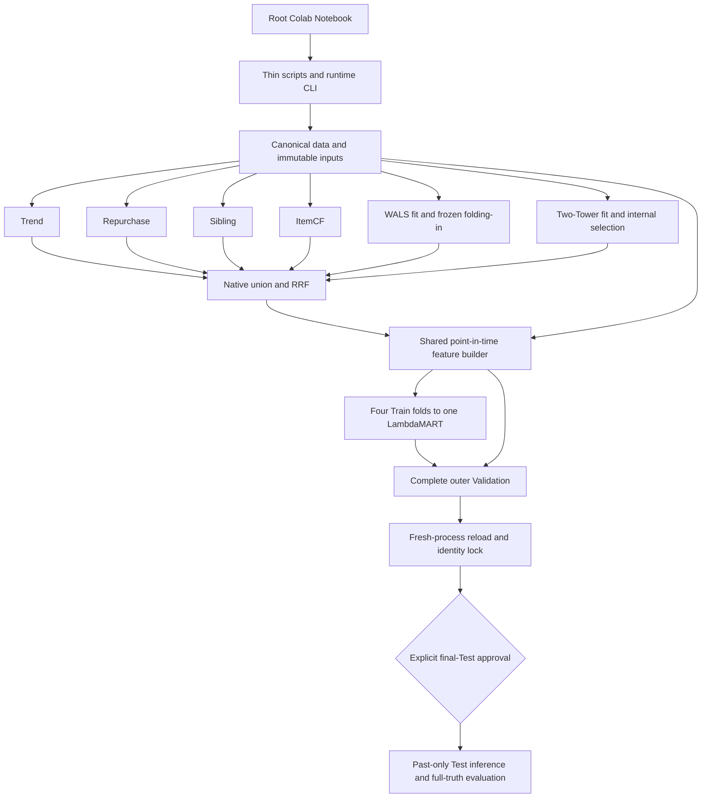

# H&M Single-Source Recommendation Architecture

**Algorithm/protocol version:** v0.3.2 / Evaluation Protocol v2.0  
**Source layout:** canonical modular packages and one root Colab client  
**Execution evidence:** see the refactor report; this diagram does not claim a
new full H&M, CUDA or final-Test run.

## Contents

- [1. Authority and boundaries](#1-authority-and-boundaries)
- [2. Canonical package and call graph](#2-canonical-package-and-call-graph)
- [3. Explicit executable stages](#3-explicit-executable-stages)
- [4. Data and model contracts](#4-data-and-model-contracts)
- [5. Temporal and evaluation boundaries](#5-temporal-and-evaluation-boundaries)
- [6. Storage, identities and recovery](#6-storage-identities-and-recovery)
- [7. Active source and historical material](#7-active-source-and-historical-material)

## 1. Authority and boundaries

[Proposal v0.3.2](../proposal.md), [Evaluation Protocol v2.0](evaluation_protocol.md),
[implementation decisions](implementation_decisions.md) and root
[AGENTS.md](../../AGENTS.md) control the learning and evaluation contract. A
module move does not change dates, quotas, sampling, features or metrics.

The system predicts unique articles purchased in the next seven calendar days.
It has exactly six logical recall channels and one learned LambdaMART ranker.
RRF is a rule baseline and ranking feature. Text/image embeddings are frozen
input modalities, not two additional retrieval channels. Purchase absence is a
proxy negative, not an observed impression or causal dislike.

There is one authoritative implementation under `src/hm_recsys/`. Smoke and
full select explicit data/resource/compute configurations around the same
algorithms. The only active Notebook is
[`colab_training_val.ipynb`](../../colab_training_val.ipynb). It calls explicit
stages rather than copying model or evaluation code into cells.

## 2. Canonical package and call graph

| Package | Responsibility and important interfaces | Primary consumers |
|---|---|---|
| `core/` | `Config`, IDs, exact split manifests, deterministic keys and progress framing | All canonical packages; no model fitting at import |
| `data/` | `History`, canonical monthly Parquet, bounded transaction/target/query readers, `Partition`, independent rosters/full truth | Preparation, all retrievers, feature and evaluation adapters |
| `retrieval/` | Six channel algorithms, cutoff snapshots, native `Hit`, learned search and channel-output pipeline | Named retrieval workers and inference |
| `retrieval/wals/` | Confidence CSR, WALS fit, fixed-item user folding-in, persisted factors/maps | WALS stage and frozen inference |
| `retrieval/two_tower/` | Trainable model/LogQ loss, raw-input caches, batched encoders, trainer/internal selection and frozen inference | Two-Tower stage, query encoding and reload |
| `fusion/` | `Candidate`, native merge, source attribution, persisted candidate reader and union/RRF evaluation | Fusion, shared features and rule comparison |
| `features/` | Content validation/adapters, frozen preprocessing, one `FeatureBuilder`, columnar feature storage | Training, Validation, authorized Test and reload |
| `ranking/` | Query-local Train-only sampling, matrices/groups, one LambdaMART fit, deterministic scoring/reload | Ranker, Validation and reload stages |
| `evaluation/` | Shared macro MAP/NDCG/Recall math and streaming accumulators | Per-channel, fusion, ranking and comparison adapters |
| `runtime/` | CLI, named-stage prerequisites, identities, leases, resource guards, checkpoints, progress and verified persistence | Thin scripts and the root Notebook |

The graph shows the main executable calls and artifact boundaries; it is not
an assertion that every low-level import is listed. Resource/checkpoint helpers
support workers without entering the mathematical definition of the loss,
confidence transform, feature schema or evaluation formulas.



Representative Python call chains are:

- `scripts/run_pipeline.py` → `runtime.cli.main` → the named-stage runtime →
  `retrieval.pipeline.run_channel`, `fusion.pipeline.fuse`,
  `features.pipeline.generate` or `ranking.pipeline.train`.
- A rule channel reads cutoff snapshots/history and calls only its canonical
  `trend`, `repurchase`, `sibling` or `itemcf` implementation.
- WALS training calls `retrieval.wals.training.fit_wals`; current users use
  `retrieval.wals.model` folding-in against frozen factors.
- Two-Tower training uses `two_tower.model`, `inputs`, `prepared`, `execution`
  and `training`; frozen catalog/query encoding uses `inference` and
  `query_inputs`. Source vectors remain separate from learned vectors.
- The fusion stage persists the native union once. Feature generation consumes
  that persisted union; it must not rerun the six retrievers implicitly.
- All metric adapters use `evaluation.metrics`; the Notebook contains no
  alternative MAP implementation.

The [README source map](../../README.md#active-python-file-map) lists every
active Python file, its main interfaces and callers. The
[migration map](refactor_migration_map.md) records old-to-new identities.

## 3. Explicit executable stages

The supported per-cell command is:

```bash
python scripts/run_pipeline.py stage --stage NAME --stage-action run [OPTIONS]
```

`--stage-action resume` verifies/restores compatible prerequisites and the named
stage; `status` inspects records without building missing work. Neither means
"run every preceding stage until NAME". Missing prerequisites produce named
errors. Identity-compatible completion is checked using manifests and output
hashes, never directory existence alone.

| Stage | Its own work | Required earlier result |
|---|---|---|
| `prepare` | Input acceptance, canonical/split/catalog/content/query preparation and resource plan; Test definitions only | Explicit immutable source inputs |
| `trend` | Cutoff Trend build, candidates and per-fold retrieval evaluation | Preparation |
| `repurchase` | Past-only repurchase candidates and evaluation | Preparation |
| `sibling` | Actual product-code variant candidates and evaluation | Preparation |
| `itemcf` | Legal global sparse co-purchase indexes, candidates and evaluation | Preparation |
| `wals` | Allowed base fit/freeze, current-user folding-in, candidates and evaluation | Preparation |
| `twotower` | Allowed gradient training/internal selection, frozen encoding, candidates and evaluation | Preparation |
| `fusion` | Native union/provenance, deterministic RRF and comparison metrics | All six persisted channel outputs |
| `features` | Identical schema for F1–F4 and full native Validation | Verified union and frozen inputs |
| `ranker` | Train-only sampling/groups, one four-fold fit and Validation scoring | Complete training/Validation features |
| `validation` | Same-population rule/channel/ranker comparison, full denominators | Fitted ranker and persisted candidate/feature outputs |
| `reload` | New-process model/feature/score/Top-12 checks and frozen identity | Completed training and Validation |
| `final_test` | Once-only Test-cutoff inference/full-truth evaluation, without refit | Completed locked full run plus separate explicit approval |

Each stage publishes an aggregate `reports/NAME.json` and a verified output
manifest. Workers emit real task counts, timings, throughput, RSS, actual CUDA
allocation/reservation when available, losses and checkpoint events. Unknown
totals/ETAs remain unknown. A successful command is not a substitute for a
validated completion record.

## 4. Data and model contracts

| Component | Input | Output and invariant |
|---|---|---|
| Content | Existing independent NPY/Parquet/JSON maps and image failures | ID-aligned float vectors and masks; actual dimensions verified; originals immutable |
| Trend, quota 60 | Legal seven-day global/age-bucket purchases | Active-pool candidates; explicit fallback provenance |
| Repurchase, quota 30 | Cutoff-safe sixty-day raw history | Existing counts/decay/last-date semantics; repeat purchases eligible |
| Sibling, quota 30 | Actual product-code map and thirty-day seeds | Active variants; seed itself excluded |
| ItemCF, quota 50 | Global 28-day distinct edges/last dates | Asymmetric sparse top-100 neighbors and up to fifteen recent seeds |
| WALS, quota 50 | Full-confidence sparse matrix in allowed base window | Fixed unnormalized item factors/map; genuine current-user normal-equation solve |
| Two-Tower, quota 50 | Past-only targets/history, metadata, frozen content | Trainable projections/weights, multi-positive LogQ, selected frozen model and learned index |
| Union/RRF | Six native candidate lists | Unique query/article rows; all source ranks/scores/masks; no extra pre-ranking truncation |
| Features | Persisted union and cutoff-safe/frozen inputs | Same 49 ordered float32 columns, category maps, NaN/mask rules at training/inference |
| LambdaMART | `X[N,F]`, binary `y[N]`, contiguous `group[Q]` | One model; `sum(group)==N`; deterministic score/article-ID ordering |
| Evaluation | Independent query roster, full unique future truth, ranked unique IDs | Macro MAP@12, Recall@12 and full-truth NDCG@12; zero hits retained |

Query identity is `(customer_id, cutoff_date)`; candidate identity adds
`article_id`. IDs remain strings; articles keep ten digits with leading zeros.
Raw duplicate purchase lines survive canonicalization, while target-week labels
are unique articles. Apply the active pool before each channel's Top-K, never
to full ground truth. The native pre-deduplication bound is 270.

Only ranker Train groups may be filtered for lack of positive/negative pairs
and sampled at up to 1:20 negatives/positive with the frozen hard/random rule.
Validation/Test are unsampled native populations. Missing factors/content or
retrieval misses do not remove future truth or failed queries.

## 5. Temporal and evaluation boundaries

| Role | Legal dates / cutoff | Target interval, end exclusive |
|---|---|---|
| WALS fit | [2020-02-01, 2020-08-12) | Implicit confidence |
| WALS vocabulary | [2020-06-16, 2020-08-12) | Frozen item mapping |
| Two-Tower train | [2020-05-19, 2020-08-05) target dates | History strictly before each target day |
| Two-Tower internal selection | [2020-08-05, 2020-08-12) | Daily internal Recall@50 |
| F1 | 2020-08-11 | [2020-08-12, 2020-08-19) |
| F2 | 2020-08-18 | [2020-08-19, 2020-08-26) |
| F3 | 2020-08-25 | [2020-08-26, 2020-09-02) |
| F4 | 2020-09-01 | [2020-09-02, 2020-09-09) |
| Validation | 2020-09-08 | [2020-09-09, 2020-09-16) |
| Final Test, gated | 2020-09-15 | [2020-09-16, 2020-09-23) |

Observable history is `t_dat <= cutoff`, equivalent to `< prediction_date`.
Validate all six outer label windows as exactly seven days, pairwise disjoint
and cutoff+1 aligned. Earlier completed weeks may enter later history; weights
and learned preprocessing stay frozen. Same-day Two-Tower purchases are full
positives for masking, never an invented intraday history.

Primary AP divides by `min(12, |full_truth|)`, then averages over every eligible
query. Candidate-list LightGBM NDCG is a diagnostic with a different relevance
universe; it is not the end-to-end primary metric. RRF comparisons and signed
leave-one-source-out union Recall retain the same roster/full truth and do not
redistribute quotas. No Test-driven checkpoint/feature/quota selection is allowed.

Preparation writes Test split metadata only. The last Notebook code cell is
skipped unless Full, `RUN_FINAL_TEST`, separate `ALLOW_FINAL_TEST` and an explicit
locked signature are supplied. Runtime validation binds completed training,
Validation/reload, source, inputs, config, schema and splits before Test labels
may be constructed/read. Test inference is separate and does not refit models.

## 6. Storage, identities and recovery

Immutable inputs remain `data/original data/`, `data/text_features/` and
`data/image_features/`. No `data/raw/` or `data/embeddings/` migration occurs.
The source content indexes are optional immutable inputs and are never
replaced with learned WALS/Two-Tower indexes.

Run-scoped derived artifacts live under `data/runs/<kind>/<run_id>/`. Colab uses
local `/content/e_commerce_recsys/data/runs/colab/<run_id>/` and verified Drive
persistence beneath
`/content/drive/MyDrive/projects/e_commerce_recsys/data/runs/colab/<run_id>/`.
Canonical snapshots, candidates, feature shards, models, indexes, aggregate
reports, manifests, checkpoint states and scratch stay beneath that data root.

The stage store enforces one writer, dependency identities, source/input/config
hashes and complete output checksums. Failed or interrupted stages do not become
complete merely because files exist. Full-state Two-Tower checkpoints include
optimizer/scheduler/RNG/progress and selected model state, while model-independent
static banks remain separate. Local save and remote publication cadences differ;
a runtime loss can discard work since the latest valid remote publication.

New code/layout/config requires a new run identity. Old runs remain immutable;
no pilot renaming or hash rewriting makes them compatible. A fresh runtime must
checkout the original explicit Git SHA, restage the input whitelist and verify
persistent prerequisites before resuming a named stage. No live job is migrated
in place.

## 7. Active source and historical material

`docs/achive/` is ignored, local-only, excluded from active tests/lint/type checks,
and absent from normal GitHub checkouts. No active import, Notebook command or
CLI depends on it. Superseded source/notebook/report bytes are preserved only
after dependency/privacy review, with checksums in the migration record.
Runtime customer data stays under ignored `data/`; archive ignoring cannot
remove previously committed sensitive history.

There are no automatic DVC/MLflow/cloud-service requirements, ZIP-upload
bootstrap, deployed APIs or new recommendation models in this refactor.
The [implementation report](code_architecture_refactor_report.md) distinguishes
bounded local verification from unrun Colab/CUDA/full/Test behavior.
